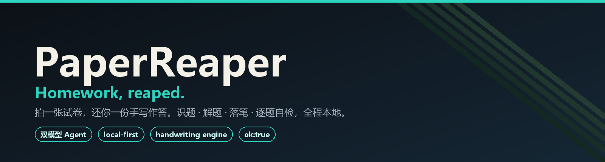
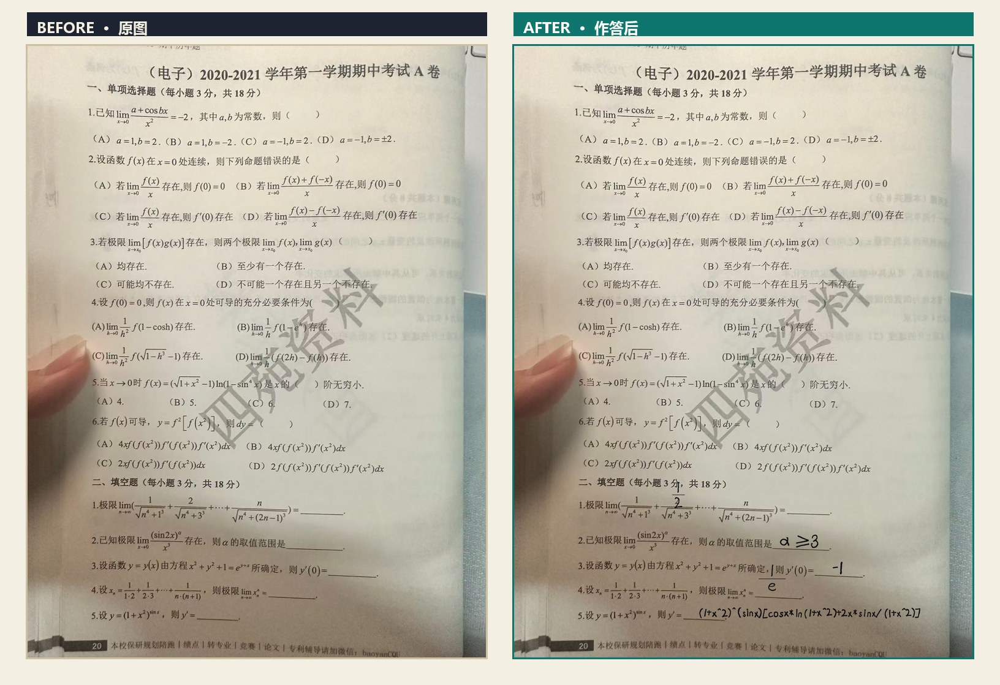
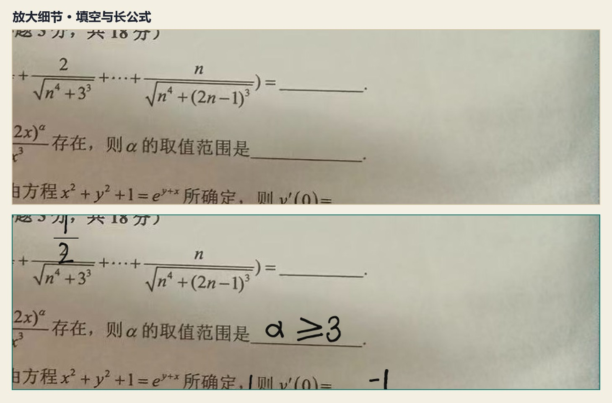
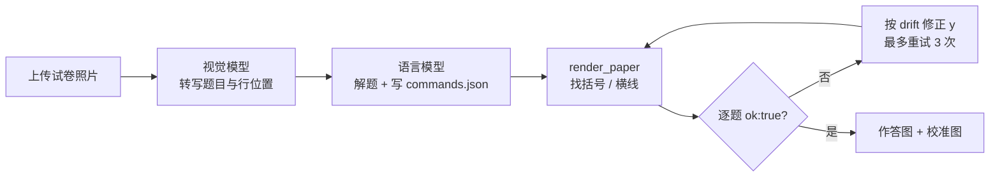
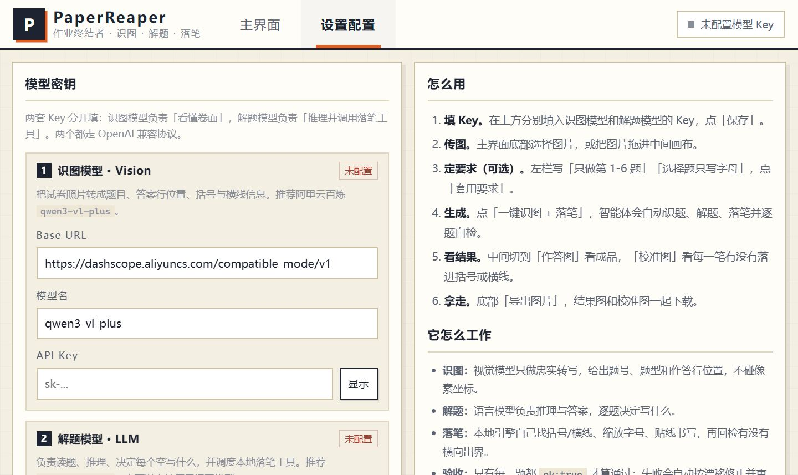
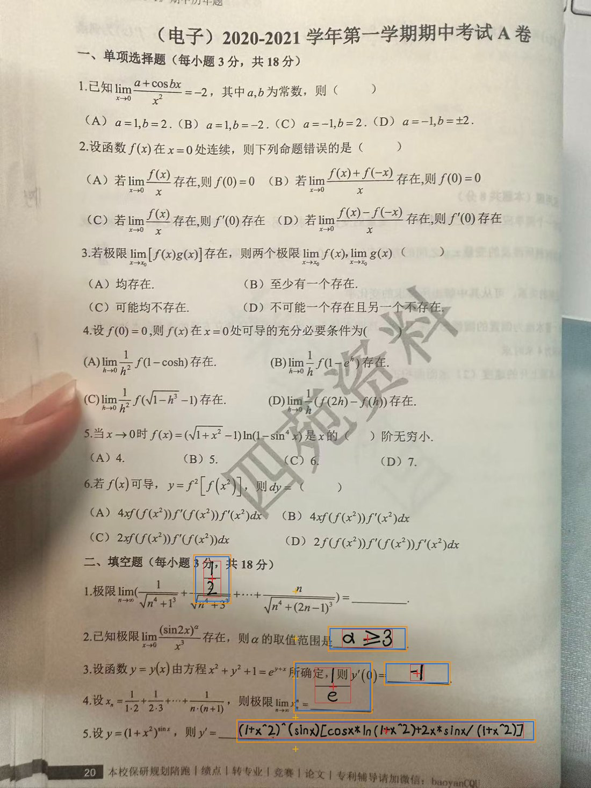

<div align="center">
  

  <h1>PaperReaper</h1>
  <p><b>作业终结者 · 拍一张试卷，还你一份手写作答</b></p>
  <p>Homework, reaped. Read it, solve it, write it — with real pen strokes.</p>

  <p>
    
    
    
    
  </p>
</div>

---

## 一眼看懂

左边是原卷，右边是它自己写出来的答案：



放大看细节：分数是上下结构，`α≥3` 自动换成符号字体，长公式贴着横线向右延伸。



> 这不是「让 AI 重画一张图」。原卷的纸张、印刷文字、题号、版式一个像素都不改，只在预留的括号和横线里落笔。

---

## 为什么叫 Reaper

大多数「AI 写作业」最后都变成两种情况：

| 常见做法 | 结果 |
| --- | --- |
| 让图像模型整页重绘 | 题干被重画、版式漂移、字迹像打印体 |
| 让模型直接给 0~1 坐标 | 照片有透视，坐标漂 1% 就写到括号外 |

PaperReaper 把工作拆成两半：

- **模型只做语义**：识题、解题、决定每个空写什么，给出「第几题 / 答案 / 大概哪一行」。
- **本地引擎做机械**：在那一行里自己找括号或横线、缩字号、贴线落笔，再回检有没有横向出界。

模型不碰像素，引擎不猜答案。失败时自动重试并明确报出题号，不会静默糊一张图给你。

---

## 特性

- **双模型 Agent**：视觉模型负责忠实转写，语言模型负责推理与工具调度，省 token 也更稳。
- **真正的工具调用**：`list_files` / `read_text` / `write_text` / `run_command` / `view_image` / `crop_image` / `render_paper` / `append_memory`。
- **逐题验收**：`render_paper` 返回每一题的 `ok / detected / drift`，只有全部 `ok:true` 才算完成。
- **自动漂移修正**：失败项按 drift 回写 `y` 重试，最多 3 次；仍失败就报题号，不假装成功。
- **机械落笔**：扫描倾斜的横线、排除函数括号、按空档宽度缩字号、墨迹底边贴线。
- **两种笔迹**：签字笔 / 铅笔，整卷统一；支持 6 种涂改样式（可选）。
- **两套 Key 分开填**：识图模型和解题模型各自独立，Key 只存在本机浏览器。
- **完全本地**：Node 静态服务 + Python 引擎，没有云端账号，没有数据库，没有遥测。

---

## 工作流



Agent 最多跑 20 步；同一工具重复调用会被拦截；验收通过后会锁死，禁止再改 `commands.json`。

---

## 快速开始

### 0. 环境

- Windows 10/11（当前主要验证平台）
- Node.js 18+
- Python 3.10+
- 一份可用的视觉模型 Key（推荐 `qwen3-vl-plus`）和语言模型 Key（推荐 `deepseek-chat`）

### 1. 安装依赖

```bash
pip install -r engine/requirements.txt
```

### 2. 放入字体

仓库不附带字体文件（版权原因）。把下面 4 个字体放进 `engine/fonts/`：

```
engine/fonts/xiongdi.ttf     # 主字体
engine/fonts/cicada.ttf      # α ≥ ∑ √ 等符号
engine/fonts/newleaf.otf     # 备用字形
engine/fonts/qishan.ttf      # 备用字形
```

详见 [`engine/fonts/README.md`](engine/fonts/README.md)。换字体改 `engine/api.py` 顶部的 `FONT` 即可。

### 3. 启动

双击 **`启动.bat`**，或在项目根目录运行：

```bash
node server.js
```

浏览器会自动打开 `http://127.0.0.1:8765`。

### 4. 填两套 Key

打开「设置配置」：



- **识图模型**：Base URL + 模型名 + API Key，负责看懂卷面。
- **解题模型**：Base URL + 模型名 + API Key，负责推理和调用工具。

点「测试两个 Key」会分别请求两边的 `/models`；点「保存」写入浏览器 localStorage。

> 不想在网页里填？把 Key 写进 `engine/.env`（参考 `engine/.env.example`）也可以，网页会回退到它。

### 5. 出图

回到主界面，上传试卷 → 点「一键识图 + 落笔」。中间可以切：

- **作答图**：最终成品
- **校准图**：每题一个蓝框（空档）+ 红十字（落点）+ 红框（墨迹），横向越界会标红

---

## 两个 Key 分别做什么

| | 识图模型 Vision | 解题模型 LLM |
| --- | --- | --- |
| 任务 | 把照片转成题目、题型、作答行位置 | 读题、推理、决定答案、调用工具 |
| 输入 | 试卷图片 | 转写结果 + 工具返回 |
| 推荐 | `qwen3-vl-plus`（阿里云百炼） | `deepseek-chat`（DeepSeek） |
| 必须支持 | 图片输入 + JSON 输出 | Function calling |

两套可以填同一个服务商、同一个模型；分开只是为了更省 token、也方便替换。

---

## 校准图是什么

每一题都会回检：

- **蓝框**：工具找到的括号空档或横线
- **红十字**：实际落笔中心
- **红框**：墨迹包围盒

验收只查横向：墨迹左右不得越出空档（±2px）；纵向允许超出括号，避免字号被括号高度压得很小。



---

## 目录结构

```
paperreaper/
├─ index.html            前端界面
├─ app.css
├─ app.js                识图 / 生成 / 双 Key / SSE 日志
├─ server.js             零依赖本地服务：静态文件 + /api/agent + /api/test-keys
├─ 启动.bat
├─ AGENTS.md             Agent 作答规范（运行时会被复制进工作目录）
├─ engine/
│  ├─ agent_runtime.py   工具化 Agent：20 步上限、重复调用拦截、验收锁死
│  ├─ auto_render.py     命令解析 + 落笔 + 校准图
│  ├─ api.py             字体渲染、墨迹纹理、分数结构
│  ├─ align.py           整页漂移估计与修正
│  ├─ render.py
│  ├─ requirements.txt
│  └─ fonts/             字体放这里（不随仓库分发）
├─ examples/             原图 / 作答图 / 校准图
└─ docs/                 README 展示图
```

运行时产物写到 `.agent_runs/`（已 gitignore）。

---

## 隐私与安全

- 仓库里**没有任何真实 API Key**，`app.js` 的默认 Key 为空。
- Key 只保存在浏览器 localStorage；运行任务时通过 `localhost` 传给本地 Node，再以环境变量传给 Python 子进程，**不写磁盘**。
- 试卷图片只在本机流转，不上传任何服务器（除了你自己配置的模型服务商）。
- `engine/.env` 与 `.agent_runs/` 默认被 `.gitignore` 忽略。
- 命令执行有白名单（`python / dir / type / copy` 等），路径限制在项目目录内。

如果你要部署到公网，请自己加鉴权、限流和 HTTPS；当前定位是本机工具。

---

## 常见问题

**Q：为什么答案看起来像打印体？**
A：检查 `engine/fonts/` 是否放了 `xiongdi.ttf`、`cicada.ttf`；缺字体时会回退，效果会明显变差。也可以在 `app.js` 里切换「学习你的字体」，用往期作答照片校准墨色、字号与工整度。

**Q：某一题总是写到括号外？**
A：看校准图。如果是 `ok:false`，Agent 会自动改 `y` 重试；如果是视觉模型把长公式判成了 `work`，在 `AGENTS.md` 里强调「长公式走 fill」即可。

**Q：`/api/test-keys` 返回 404？**
A：确认用的是本仓库的 `server.js`，并且是通过 `启动.bat` 启动，而不是直接双击 `index.html`。

**Q：能不用 Node 吗？**
A：前端可以静态打开，但 `/api/agent` 和 `/api/test-keys` 需要本地服务。Node 只是零依赖的胶水层。

**Q：能换成别的模型吗？**
A：只要兼容 OpenAI Chat Completions、支持图片输入（视觉）或 function calling（解题）即可。

---

## Roadmap

- [ ] macOS / Linux 启动脚本
- [ ] 多页试卷批量作答
- [ ] 字体自动匹配（从往期作业学习字形）
- [ ] 浏览器端实时预览落笔轨迹
- [ ] Docker 一键运行

---

## 字体与内容声明

- 代码以 MIT 协议开源；**字体文件不包含在仓库中**，请自行获取并遵守其授权。
- `examples/` 中的试卷图片仅用于演示本项目效果，版权归原出题方所有；如介意可自行删除。
- 请遵守你所在学校/机构关于作业与考试的规定，本项目仅用于学习与效率工具演示。

## License

[MIT](LICENSE)
